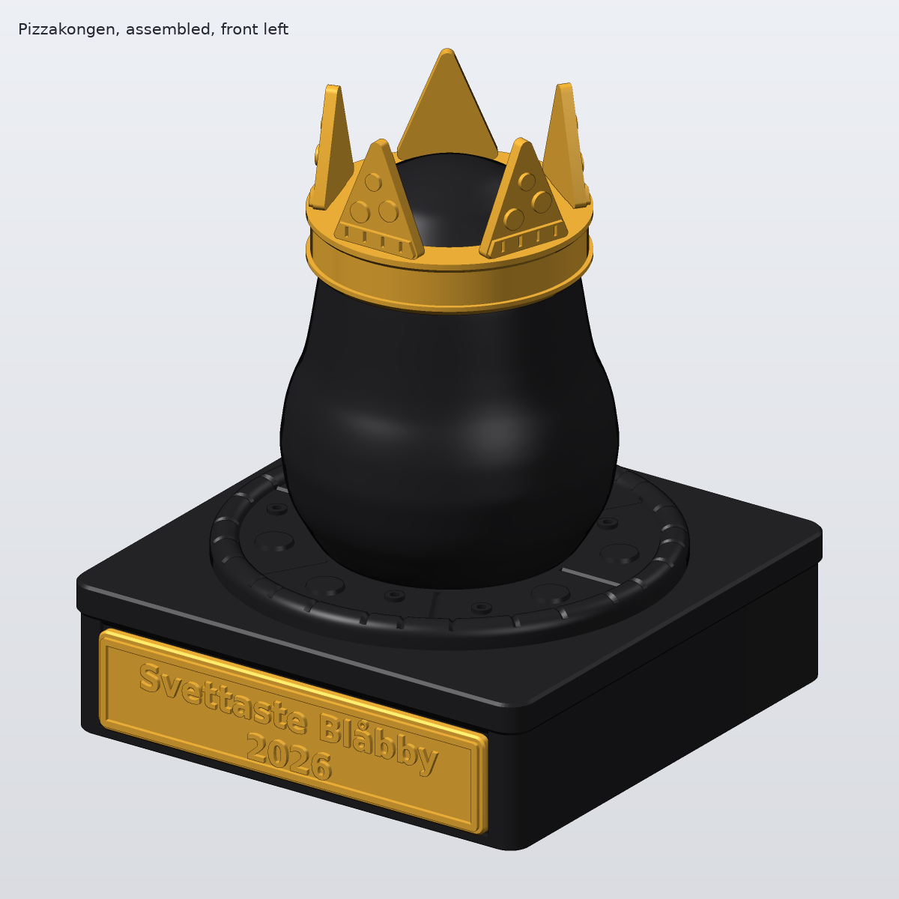

# Pizzakongen trophy

A first concept model of the tournament trophy. An upright Blobby blob wears a crown of five pizza slices. It stands on a round pizza that sits on a closed pizza box. The front of the box holds a plaque with "Svettaste Blåbby" and the year.

The blob is spun from the real outline of `data/gfx/blobbym1.bmp` in the game. Like the game art, it has no face.



Overall height: 170.0 mm. Footprint: 142 x 144 mm.

## Parts

Print one of each part, except the slices. The weights assume PLA with 4 walls and 15 percent infill. They are rough figures from the model volume.

| Part | File | Colour | Print orientation | Approx. filament |
|---|---|---|---|---|
| Base (box and pizza) | `stl/pizzakongen_base.stl` | Black | Upright, box bottom on the bed | 276 g |
| Blob | `stl/pizzakongen_blob.stl` | Black, silk or glossy if you have it | Upright, flat foot on the bed | 131 g |
| Crown band | `stl/pizzakongen_crown_band.stl` | Silk gold | Upright, as exported | 21 g |
| Pizza slice, print 5 | `stl/pizzakongen_slice.stl` | Silk gold | Flat, back on the bed, toppings up | 2 g each |
| Plaque | `stl/pizzakongen_plaque.stl` | Silk gold | Flat, text facing up | 14 g |
| Pin | `stl/pizzakongen_pin.stl` | Any | Lying on its flat side | 1 g |

The total is about 455 g. The STL files are already in print orientation.

Black base and blob with a gold crown and plaque gives the most contrast. All details are relief, so every part also works in one colour. The text, frame and toppings stand 1.2 mm proud. The cheese cuts and crust notches are 1 mm deep. The plaque text is DejaVu Sans Bold, about 7 mm cap height.

No part needs supports. The steepest surfaces are 45 degrees, on purpose. These are the bottom chamfers against elephant's foot, the underside of the box lid, the roof of the plaque pocket, the undersides of the crown band rings and the pointed roof of the pin socket in the blob. The blob belly is at most 37 degrees from vertical. The inside of the crown band follows the head at up to 44 degrees.

## Assembly

1. Test fit the pin in the socket on the top of the base and in the socket under the blob. The flat side of the pin matches the flat side of each socket. If it is too tight, sand the pin or reprint with a larger tolerance.
2. Glue the pin into the base, then glue the blob onto the pin. Use CA glue for PLA and two-part epoxy for PETG.
3. Push the tab of each slice into a slot in the crown band, toppings facing out. Glue them.
4. Lower the crown band over the head. The inside follows the shape of the head, so it seats by itself. Glue it.
5. Glue the plaque into the pocket on the front of the box, text up.

## Change the year or the text

Install the packages once, then run the script:

```
pip install -r requirements.txt
python pizzakongen.py --year 2027
python render_previews.py
```

The first command writes all STL files to `stl/` and prints the checks. Only the plaque changes with the year, so you can export just that part with `--part plaque`. You can also edit `YEAR` and `TEXT` at the top of `pizzakongen.py`. The text size adjusts to fit the plaque. The script stops with an error if the font has no glyph for a letter.

Other options:

- `--text "..."` changes the first line.
- `--height 150` to `--height 200` sets the overall height. The blob scales to match.
- `--tolerance 0.3` is the total clearance for every fit. Use 0.3 for PLA and 0.4 for PETG.
- `--part blob` exports a single part. The choices are `all`, `blob`, `crown_band`, `slice`, `base`, `plaque` and `pin`.

`NUM_SLICES` at the top of the script sets the number of slices. Use 3 or 1 for 2nd and 3rd place.

## Checks

Each run checks every part. It must be one closed, valid mesh with a flat bottom at z = 0, and it must fit the 256 x 256 x 256 mm bed of the Bambu Lab P1S. Faces steeper than 45 degrees are also checked. The script stops if the blob belly, the band seat or the walls around the slice slots break those limits.

## Files

- `pizzakongen.py` builds the parts with manifold3d, runs the checks and writes the STL files.
- `render_previews.py` writes the PNG previews to `renders/`.
- `requirements.txt` lists the Python packages.
