# Pizzakongen trophies

A set of three trophies for 1st, 2nd and 3rd place, each with its own hat. Every trophy is an upright Blobby blob on a black stepped plinth with a plaque on the front. The blob is spun from the real outline of `data/gfx/blobbym1.bmp` in the game. Like the game art, it has no face.

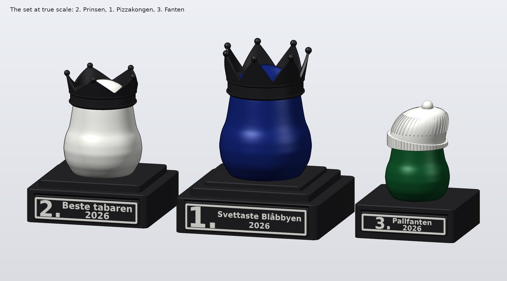

| Place | Name | Blob | Hat | Base | Scale | Height | Footprint |
|---|---|---|---|---|---|---|---|
| 1 | Pizzakongen | Dark blue | Black crown, 7 points | 3 tiers | 100 % | 170 mm | 140 x 143 mm |
| 2 | Prinsen | White | Black prince's crown, 5 lower points | 2 tiers | 85 % | 139 mm | 119 x 122 mm |
| 3 | Fanten | Dark green | White knit beanie with a pompom | 1 tier | 70 % | 126 mm | 98 x 101 mm |

The scale applies to the blob, the base and the plaque. The walls, the fits, the pin and every height that a filament switch depends on keep their full size values, so the small trophies print as well as the big one.

## Colours

The filaments on hand are black, white, dark blue and dark green. The base, the pin and the plaque plate are black on every trophy. The plaque letters are white.

- Pizzakongen has a dark blue blob. The game draws the left blob in pure blue (RGB 0, 0, 255 in `data/config.xml`). Dark blue is the only blue filament on hand, so it is the closest match. The crown is black.
- Prinsen has a white blob and a black crown.
- Fanten has a dark green blob and a white beanie.

Every part is one colour, except the plaque. The plaque gets its white letters from one filament switch. No part has more than one switch.

## Parts and filament

Run `python pizzakongen.py` to write the STL files of all three trophies, each place in its own folder: `stl/pizzakongen/place1/`, `stl/pizzakongen/place2/` and `stl/pizzakongen/place3/`. The files are already in print orientation. The weights assume PLA with 4 walls and 15 percent infill. They are rough figures from the model volume.

| Part | File | Print orientation | 1. Pizzakongen | 2. Prinsen | 3. Fanten |
|---|---|---|---|---|---|
| Blob | `blob.stl` | Upright, flat foot on the bed | 131 g dark blue | 86 g white | 52 g dark green |
| Hat | `crown.stl` or `beanie.stl` | Upright, open side on the bed | 34 g black | 22 g black | 32 g white |
| Base | `base.stl` | Upright | 257 g black | 176 g black | 111 g black |
| Plaque | `plaque.stl` | Flat, front facing up | 13 g black, 1 g white | 9 g black, 1 g white | 6 g black, 1 g white |
| Pin | `pin.stl` | Lying on its flat side | 1 g black | 1 g black | 1 g black |

Filament per trophy:

| Trophy | Black | White | Dark blue | Dark green | Total |
|---|---|---|---|---|---|
| 1. Pizzakongen | 306 g | 1 g | 131 g | | 438 g |
| 2. Prinsen | 208 g | 87 g | | | 295 g |
| 3. Fanten | 119 g | 33 g | | 52 g | 204 g |
| The set | 633 g | 121 g | 131 g | 52 g | 937 g |

Each place has its renders in `renders/place1/`, `renders/place2/` and `renders/place3/`: the assembled trophy from the front and from the front left, a close up of the hat and the plaque, and every print part on the bed.

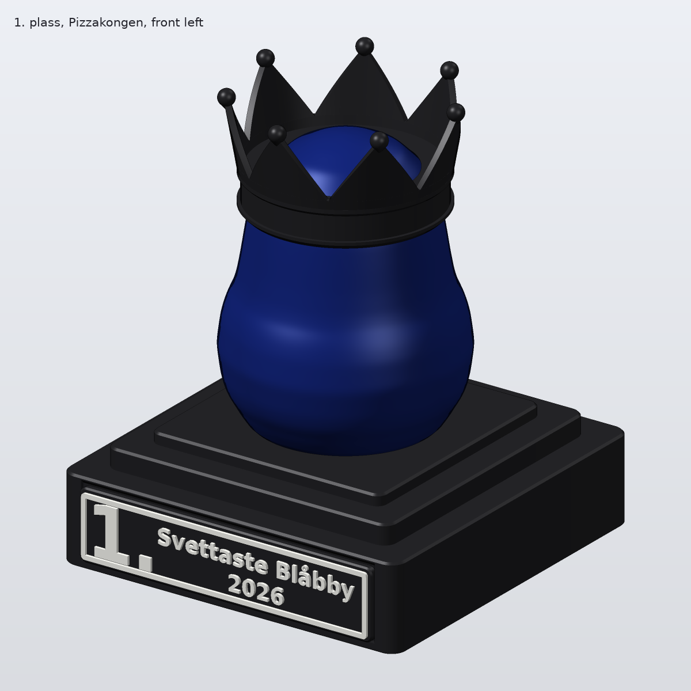

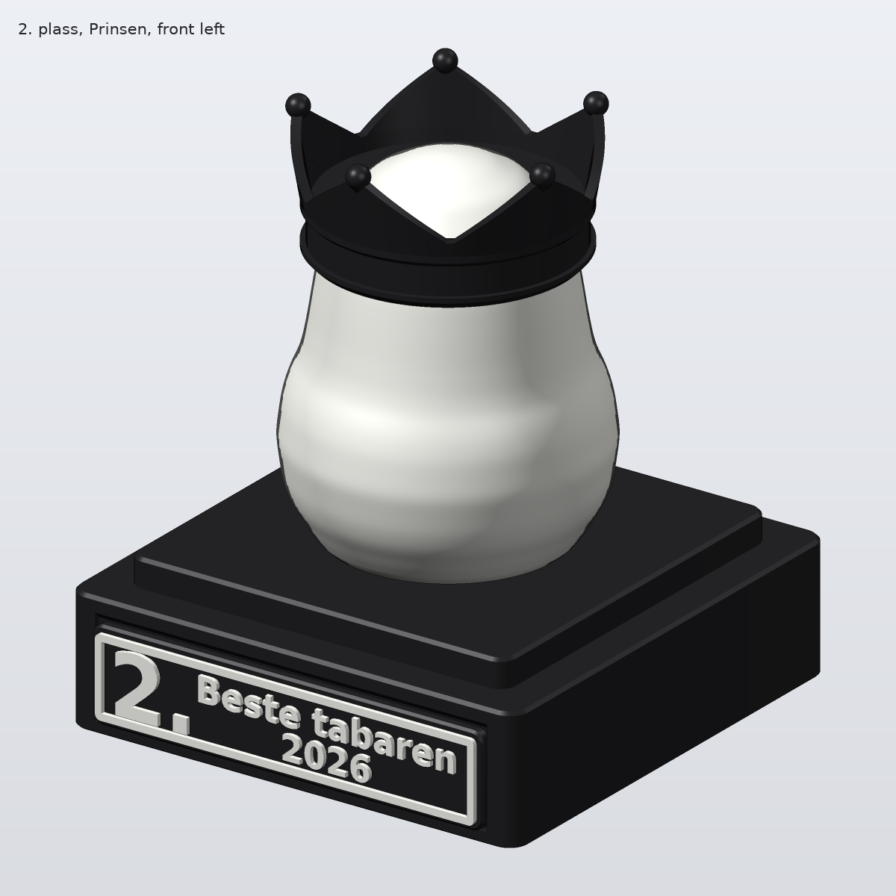

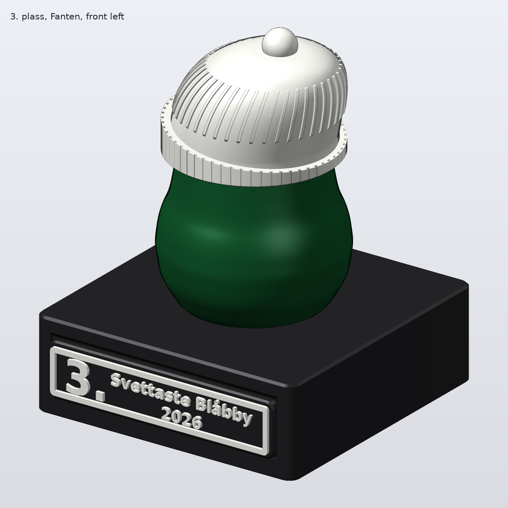

### Crowns

Pizzakongen and Prinsen have the same kind of crown. The band seats on the head, because its inside is the head surface plus the fit tolerance. On top of the band stands a 2.4 mm wall that rises into points with a ball on each tip. The points lean 10 degrees outward. Pizzakongen has 7 points, 30 mm above the band. Prinsen has 5 points, only 20 mm above the band, with smaller balls. One point faces the front on both. Each ball has a cone under it at 42 degrees, so its underside prints without support.

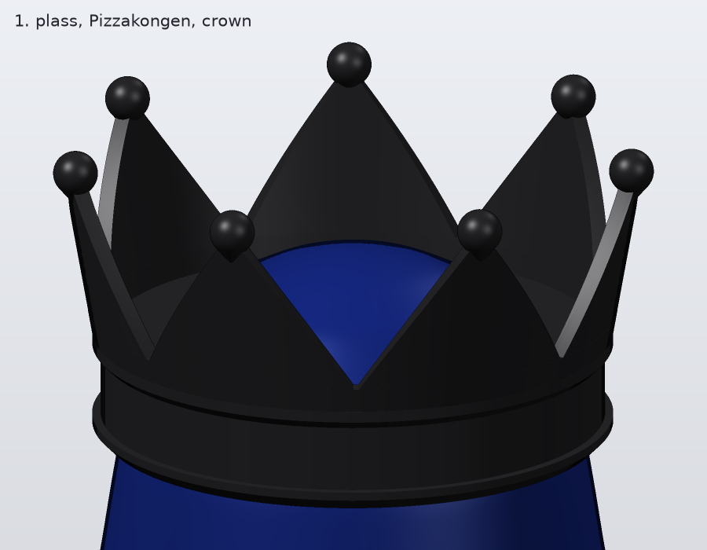

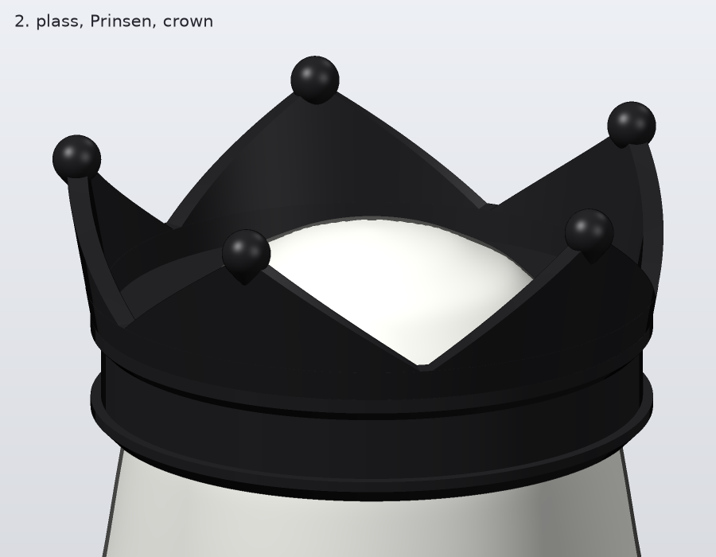

`PLACES` at the top of `pizzakongen.py` sets the points, height and ball size per place. Keep the number of points odd, so the front view shows a single ball at the front instead of two balls in a line.

### Beanie

Fanten wears a slouchy knit beanie, pulled down over the head. The turned up cuff has vertical ribs and its top is cut at 8 degrees, so the beanie looks pulled down on one side. The knit leans to the side and carries knitted ribs and a pompom. The bottom of the cuff stays flat for the bed.

The inside follows the head down at the edge, like the crown band, so the beanie seats by itself. Where the head gets steeper than 45 degrees, the inside turns into a 45 degree cone over the top of the head. So the beanie prints upright with no support. The rib ends taper and the pompom has a cone under it for the same reason.

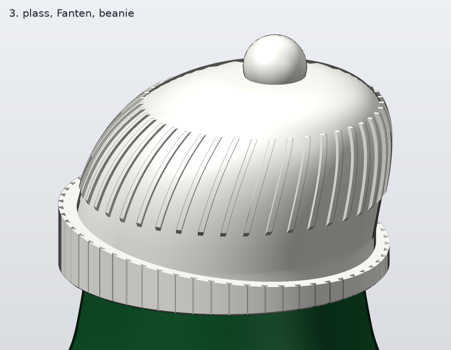

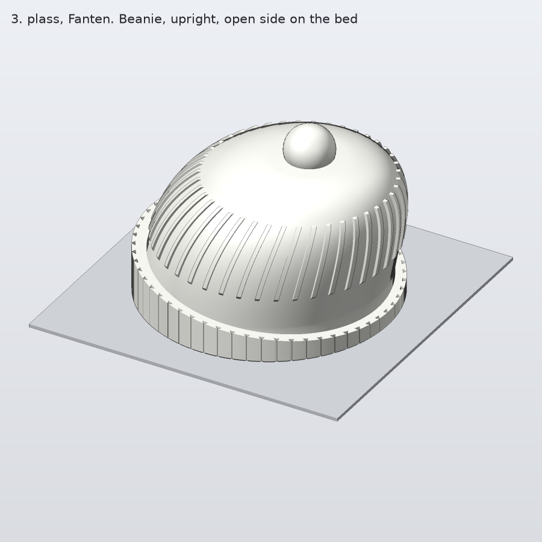

A bindle stick was left out. It would need its own mount on the base, and the cloth bundle has no flat side to print on without support.

### Plaque

The plaque is 122 x 28 mm on Pizzakongen and scales with the trophy, to 104 x 24 mm on Prinsen and 85 x 20 mm on Fanten. Its thickness, the 1.2 mm relief and the pocket depth stay the same.

Each place has its own text, set with `text` in `PLACES` at the top of `pizzakongen.py`:

| Place | Text |
|---|---|
| 1. Pizzakongen | Svettaste Blåbbyen |
| 2. Prinsen | Beste tabaren |
| 3. Fanten | Pallfanten |

Two layouts are built in, and `--plaque` picks one:

- `number` (default): a big place number on the left, the text and the year on the right.
- `lines`: "1. plass" over the text and the year, for example "Svettaste Blåbbyen 2026".

The big number reads better, mostly on the small plaques. With `number` the text has a cap height of 5.5 mm on Pizzakongen, 6.3 mm on Prinsen and 4.9 mm on Fanten. With `lines` Fanten drops to 4.3 mm. The script stops if any text is below 3 mm cap height (`MIN_CAP`). The smallest letters, on Fanten, have 1.2 mm stems, three nozzle widths. A long text on a small plaque gives thin strokes, so keep the text short there.

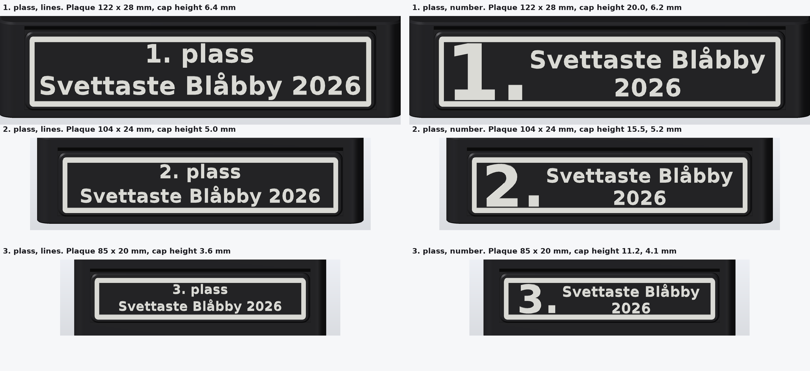

The letters and frame are raised 1.2 mm on a black plate and print in white after one filament switch. The letters sit on the plate, so they need no bridges, and the ring of the å is held by the plate as well.

Run with `--stencil`, or set `STENCIL = True`, to get the one colour stencil plaque instead. The text is cut all the way through the plaque and the floor of the pocket shows through the letters. Closed letters then need 1.2 mm bridges, which the script adds by itself. With the black base behind it, a stencil plaque does not read, so use the raised text.

### Print notes

The printer has no AMS, so the plaque gets its second colour from one filament switch. Layers are 0.2 mm, the first layer included. Layer N is printed from Z = (N - 1) x 0.2 mm to N x 0.2 mm, so pause before layer N starts. Bambu Studio shows each layer by its top height, so layer 16 shows as 3.20 mm in the layer slider.

- Plaque, all three places: start in black. Pause at layer 16 (Z 3.0 mm), change to white. The plate is 3.0 mm, the letters and frame stand 1.2 mm above it.

In Bambu Studio, open the layer slider in the preview, go to the layer at 3.20 mm, right click the plus sign and pick "Add pause". The printer stops there. Change the filament by hand and resume. The script prints the pause layer for every run, so check it after you change `PLAQUE_T` or `TEXT_RELIEF`.

No part needs supports. The steepest surfaces are 45 degrees, on purpose. These are the bottom chamfers against elephant's foot, the roof of the plaque pocket, the undersides of the crown band rings, the inside cone of the beanie and the pointed roof of the pin socket in the blob. The blob belly is at most 37 degrees from vertical. The inside of the crown band and of the beanie follows the head at up to 45 degrees.

### Base styles for Pizzakongen

Pizzakongen can also take one of four other bases. The default is `tiers`. Pick another with `--base` or with `BASE_STYLE` at the top of `pizzakongen.py`. Prinsen and Fanten use the tiers base only. Every style keeps the same blob seat, pin socket and plaque pocket, so the blob, the crown, the plaque and the pin stay the same. Every style is black, has a flat bottom, fits within 142 x 142 mm and has no faces steeper than 45 degrees.

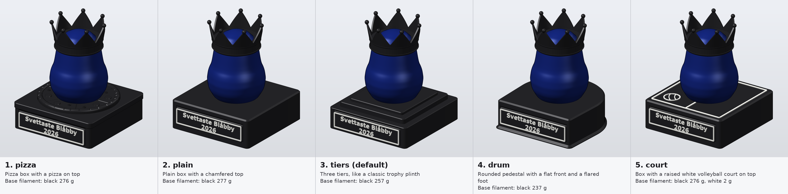

| Style | Look | Base filament |
|---|---|---|
| `pizza` | Pizza box with a lid line and a pizza on top | 276 g black |
| `plain` | Plain box with a 2 mm chamfer round the top. The plaque sits in the middle of the front | 277 g black |
| `tiers` (default) | Three stepped tiers, like a classic trophy plinth. The plaque sits in the bottom tier | 257 g black |
| `drum` | Rounded pedestal with a flat front for the plaque and a flared foot | 237 g black |
| `court` | Plain box with a raised white volleyball court on top: the court lines, the net line and a ball | 276 g black, 2 g white |

The `court` style has a second filament switch, on the base. Start in black. Pause at layer 233 (Z 46.4 mm, slider 46.60) and change to white. The lines stand 1.2 mm above the top. The top of this base is 46.4 mm instead of 46.5 mm, so the switch falls on a layer boundary. The trophy is then 169.9 mm tall.

A regular hexagon or octagon base does not work. The plaque needs a flat front about 124 mm wide, and an octagon 140 mm across has 58 mm sides.

Each style has an assembled render and a print render in `renders/bases/`, for example `renders/bases/tiers_angle.png` and `renders/bases/tiers_print_base.png`. Run `python render_previews.py --bases` to render them again. `python pizzakongen.py --place 1 --base drum --part base` writes the base of one style to `stl/pizzakongen/place1/base.stl`, in place of the default.

## Assembly

1. Test fit the pin in the socket on the top of the base and in the socket under the blob. The flat side of the pin matches the flat side of each socket. If it is too tight, sand the pin or reprint with a larger tolerance.
2. Glue the pin into the base, then glue the blob onto the pin. Use CA glue for PLA and two-part epoxy for PETG.
3. Lower the hat over the head. Turn a crown so a point faces the front. Turn the beanie so the low side of the cuff is on the right, seen from the front. The inside follows the shape of the head, so it seats by itself. Glue it.
4. Glue the plaque into the pocket on the front of the base, with the year at the bottom.

## Commands

Install the packages once, then run the scripts:

```
pip install -r requirements.txt
python pizzakongen.py --year 2027
python render_previews.py
```

The first command writes the STL files of all three places to `stl/pizzakongen/placeN/` and prints the checks and the filament per trophy. The second writes every render, the lineup and the plaque sheet to `renders/`. Only the plaque changes with the year, so you can export just that part with `--part plaque`. You can also edit `YEAR` and `TEXT` at the top of `pizzakongen.py`. The text size adjusts to fit the plaque. The script stops with an error if the font has no glyph for a letter.

Options for `pizzakongen.py`:

- `--place 2` builds one trophy. The choices are `1`, `2`, `3` and `all` (default).
- `--plaque lines` picks the plaque layout: `number` (default) or `lines`.
- `--text "..."` sets the plaque text of every place for one run. Edit `PLACES` to change one place for good.
- `--height 150` to `--height 200` sets the height of Pizzakongen. The other two scale with it.
- `--tolerance 0.3` is the total clearance for every fit. Use 0.3 for PLA and 0.4 for PETG.
- `--stencil` makes the one colour stencil plaque instead of raised text.
- `--base plain` picks the base style of Pizzakongen: `pizza`, `plain`, `tiers`, `drum` or `court`.
- `--part blob` exports a single part. The choices are `all`, `blob`, `hat`, `base`, `plaque` and `pin`.

`render_previews.py` takes `--place` too, and `--bases` for the base styles.

## Checks

Each run checks every part of every trophy. It must be one closed, valid mesh with a flat bottom at z = 0, and it must fit the 256 x 256 x 256 mm bed of the Bambu Lab P1S. Faces steeper than 45 degrees are also checked. The script stops if the blob belly, the band seat or the beanie seat break those limits, if a crown wall does not stand on its band, if the plaque does not fit the bottom tier or if the plaque text gets too small.

## Files

- `pizzakongen.py` builds the parts with manifold3d, runs the checks and writes the STL files.
- `render_previews.py` writes the PNG previews to `renders/`.
- `requirements.txt` lists the Python packages.

# Alternative concepts

Two other trophies that look clearly different from Pizzakongen. They use the same plaque text options, the same 0.3 mm tolerance and the same checks. Shared code is in `alt_common.py`, copied from `pizzakongen.py` and `render_previews.py`. Each script writes its STL files to `stl/<name>/` and, with `--render`, its previews to `renders/<name>/`.

```
python pokalen.py --render
python foza_taarnet.py --render
```

Both scripts take `--year`, `--text`, `--height`, `--tolerance` and `--part`, like `pizzakongen.py`. `--palette` picks a colour scheme for the renders and the filament totals.

Dark blue, dark green and black are all very dark, so they look muddy next to each other. Contrast comes from white against one dark colour, and the stencil letters show the dark colour behind them. Each concept has a `compare.png` with every scheme side by side and its filament per colour.

## Pokalen

The winner's cup from the game, made real. The cup is spun from the outline of `data/gfx/pokal.bmp`, the trophy on the game's winner screen. The lid carries seven pepperoni discs. The medallion on top is a small pizza with a notched crust rim and three blobs on a podium, like the medallion in the game. The plinth holds a white nameplate with raised black letters, the text on two lines and the year on a third.

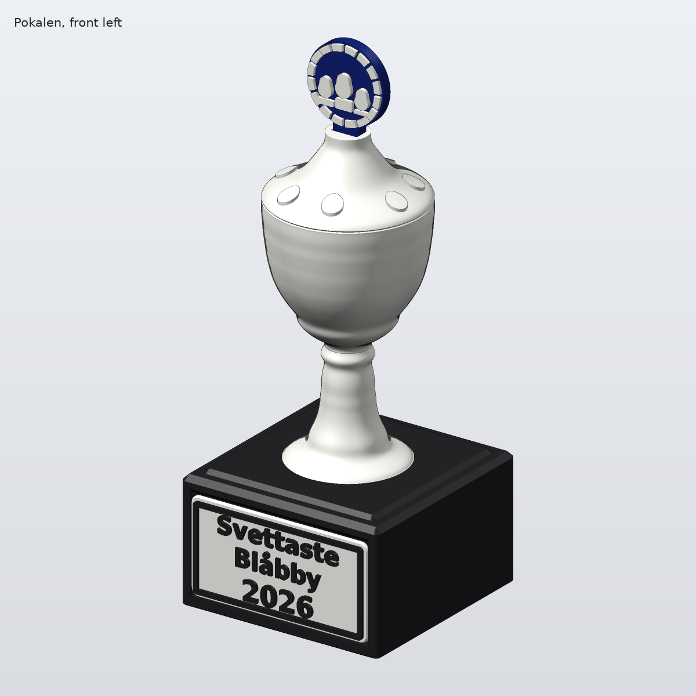

Overall height: 195 mm. Plinth: 78 x 78 mm. Cup: 56 mm across at the lid.

Each part takes the colour of what it would be on a real trophy. The plinth is black, like wood or marble. The foot and stem, bowl, lid and plaque are white, as one metal. The medallion is a dark blue enamel badge with its crust, podium and blobs in white, which also ties in with Blåbby.

| Part | File | Colour | Print orientation | Approx. filament |
|---|---|---|---|---|
| Plinth | `stl/pokalen/pokalen_plinth.stl` | Black | Upright | 97 g |
| Plaque | `stl/pokalen/pokalen_plaque.stl` | White plate, black letters (one filament change) | Flat, front facing up | 6 g |
| Foot and stem | `stl/pokalen/pokalen_foot.stl` | White | Upright | 12 g |
| Bowl | `stl/pokalen/pokalen_bowl.stl` | White | Upside down, lid face on the bed | 35 g |
| Lid | `stl/pokalen/pokalen_lid.stl` | White | Upright | 15 g |
| Medallion | `stl/pokalen/pokalen_medallion.stl` | Dark blue disc, white relief (one filament change) | Flat, front facing up | 5 g |
| Pin, print 3 | `stl/pokalen/pokalen_pin.stl` | Black, or any colour | Lying on its flat side | 1 g each |

Filament per colour, about 170 g in total: black 100 g, white 66 g, dark blue 4 g.

Print guide for the two parts that change filament. Layers are 0.2 mm, the first layer included. Layer N is printed from Z = (N - 1) x 0.2 mm to N x 0.2 mm, so pause before layer N starts. Bambu Studio shows each layer by its top height, so layer 9 shows as 1.80 mm in the layer slider.

- Plaque: start in white. Pause at layer 9 (Z 1.6 mm), change to black. The plate is 1.6 mm, the letters and frame stand 1.0 mm above it.
- Medallion: start in dark blue. Pause at layer 23 (Z 4.4 mm), change to white. The disc and tab are 4.4 mm, the crust and podium stand 1.2 mm and the blobs 1.6 mm above it.

The script prints the same guide for the chosen scheme. The renders `renders/pokalen/print_plaque.png` and `renders/pokalen/print_medallion.png` show both colours on the bed.

Other schemes, all in `renders/pokalen/compare.png`:

- `navy_white`: dark blue plinth and bowl, the rest white, dark blue letters. Dark blue 134 g, white 36 g.
- `navy_white_bowl`: dark blue plinth, the whole cup white, dark blue letters. Dark blue 100 g, white 71 g.
- `black_white`: like the default, but with an all white medallion and no change on it. Black 100 g, white 71 g.
- `old_blue_green`: the first try with black, dark blue and dark green. Kept for reference.

The pepperoni on the lid are part of the white lid. A blue pepperoni variant would need seven small separate discs glued onto a curved surface, so there is none.

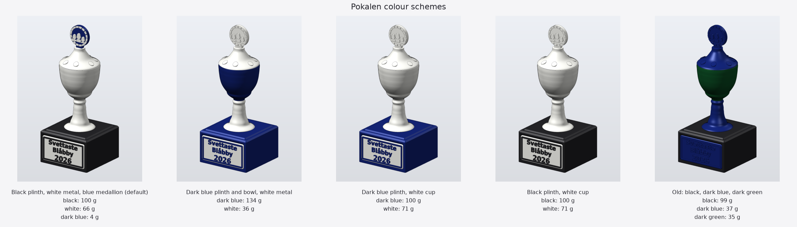

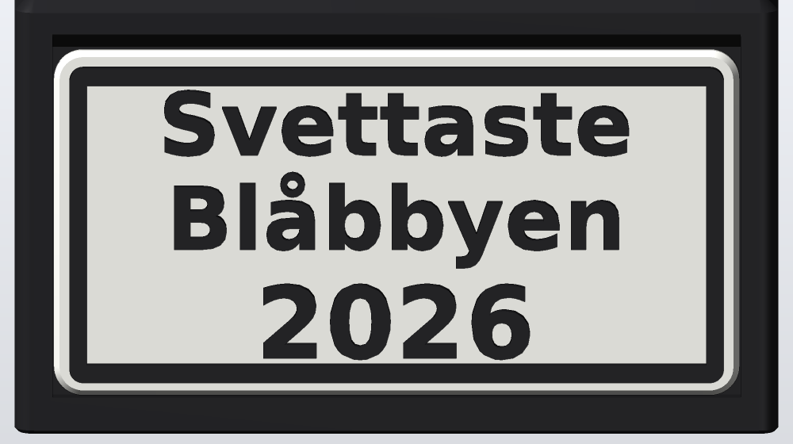


Print notes:

- No part needs supports. Every outline only narrows going up in its print orientation, or grows at 45 degrees at most. The script checks this.
- The sprite's stem is about 5 mm thick at this size, which is too weak. The model widens it to 15 mm and adds a clear ring under the bowl.
- The parts stack on 7 mm D-shaped pins: plinth to foot, foot to bowl and bowl to lid. Sockets that open onto the bed have a pointed 45 degree roof.
- The medallion has a tab that pushes into a slot in the top of the lid. Glue it.
- The plaque plate is 1.6 mm thick and sits flush in a 1.6 mm pocket, so only the black letters and frame stand out. There are no stencil bridges any more. `--stencil` brings back the stencil plaque with the letters cut through, printed in one colour, with the black pocket floor showing through.
- The trophy is light, about 175 g. If it feels tippy, print the plinth with more infill or glue a steel washer under it.

Assembly: glue a pin into the plinth, the foot onto it, a pin into the top of the foot, the bowl onto it, a pin into the bowl, then the lid and the medallion. Glue the plaque into the pocket with the glue on the frame only.

## Foza-tårnet

A blob on a wobbly stack of Foza coins, the betting points from the tournament site. Every coin is the same part, printed five times. The pin on top of each coin sits 6 mm off centre and is turned 140 degrees against the hole underneath. So each coin can only go on one way, and the stack steps round in a fixed spiral that stays centred over the base. The edge of each coin reads "FOZA" three times, with an engraved pizza slice between the words.

The base is a big coin. Its rim is a separate white ring with "Svettaste Blåbbyen" and the year cut through it. The dark blue core shows through the letters, so the text reads like the stencil plaque. Twelve pizza slices are engraved round the top of the core.

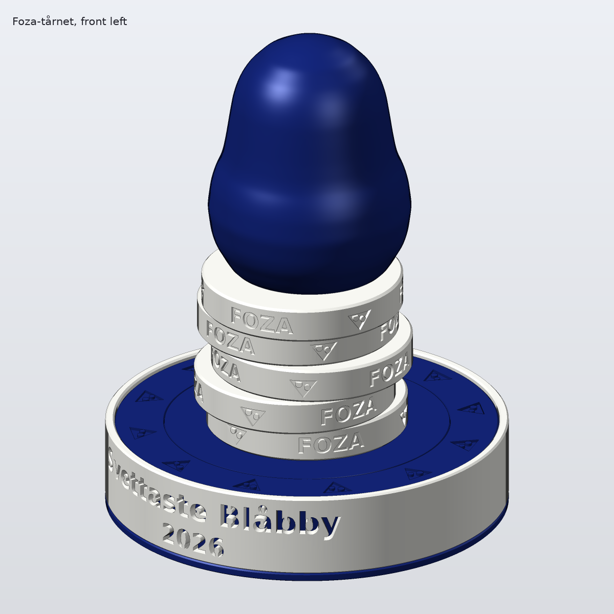

Overall height: 175 mm. Base: 140 mm across. Coins: 70 mm across and 12 mm thick. Blob: 85 mm tall.

| Part | File | Colour | Print orientation | Approx. filament |
|---|---|---|---|---|
| Base core | `stl/foza_taarnet/foza_taarnet_core.stl` | Dark blue | Upright | 153 g |
| Rim ring | `stl/foza_taarnet/foza_taarnet_ring.stl` | White | Upright | 46 g |
| Coin, print 5 | `stl/foza_taarnet/foza_taarnet_coin.stl` | White | Flat, pin up | 27 g each |
| Blob | `stl/foza_taarnet/foza_taarnet_blob.stl` | Dark blue | Upright | 75 g |

Filament per colour, about 405 g in total: dark blue 227 g, white 180 g.

The trophy reads as three bands: a dark blue blob, a white stack of coins and a dark blue base with a white rim. All coins are the same colour, so there is no stacking order to get wrong.

Other schemes, all in `renders/foza_taarnet/compare.png`:

- `navy_white`: coins alternate white and dark blue from the bottom, like a stack of chips. The top coin is white. Dark blue 281 g, white 126 g. It looks busier.
- `old_black_green`: the first try with black, dark green and dark blue. Kept for reference.

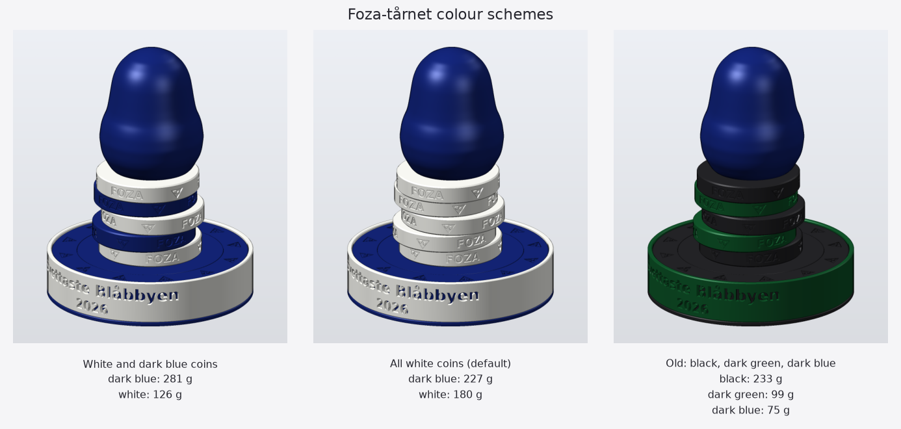

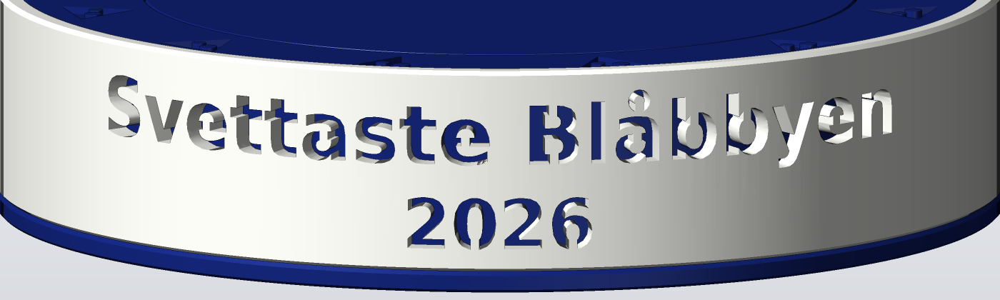

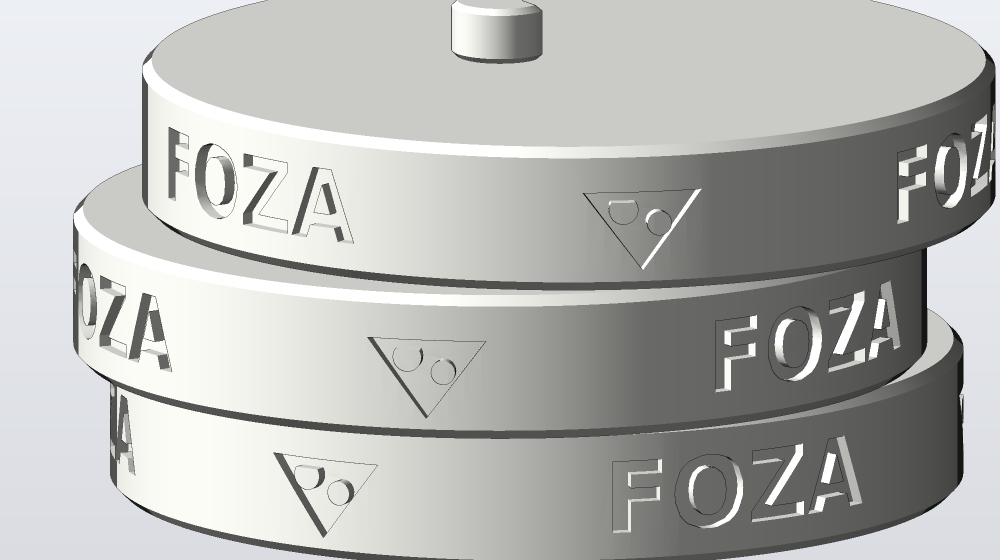

Print notes:

- The letters in the rim ring are cut through a vertical wall, so the top edge of each letter prints as a bridge. The flat part of any letter top is at most 3 mm wide. Curved tops such as S, a and 0 close in a little each layer. The P1S handles this without supports, but the tops of the letters can droop slightly. Closed letters have 1.2 mm stencil bridges, as on the Pizzakongen plaque.
- The coin edge lettering is engraved 1 mm deep. Its top edges are 1 mm overhangs and print fine.
- No part here changes filament. A raised mark on the coin tops would stop the coins from sitting flat on each other, and only the top coin shows any of its face. The rim text is on a vertical wall, so it stays a stencil.
- The pins are part of the coins and the core, 8 mm across and 4.6 mm tall. The holes under the coins and the blob have a pointed 45 degree roof.
- The ring slides over the core with 0.15 mm clearance on each side and sits on the core's flange. It stands 1.2 mm above the core like a coin rim.
- The centre of mass is within 1 mm of the base centre. The script checks it.

Assembly: glue the ring onto the core with the text at the front. Then glue the coins one by one. Each pin only fits its hole one way. Glue the blob on the top pin last.

## Files for the alternatives

- `alt_common.py` holds the shared helpers and the renderer.
- `pokalen.py` builds Pokalen.
- `foza_taarnet.py` builds Foza-tårnet.
